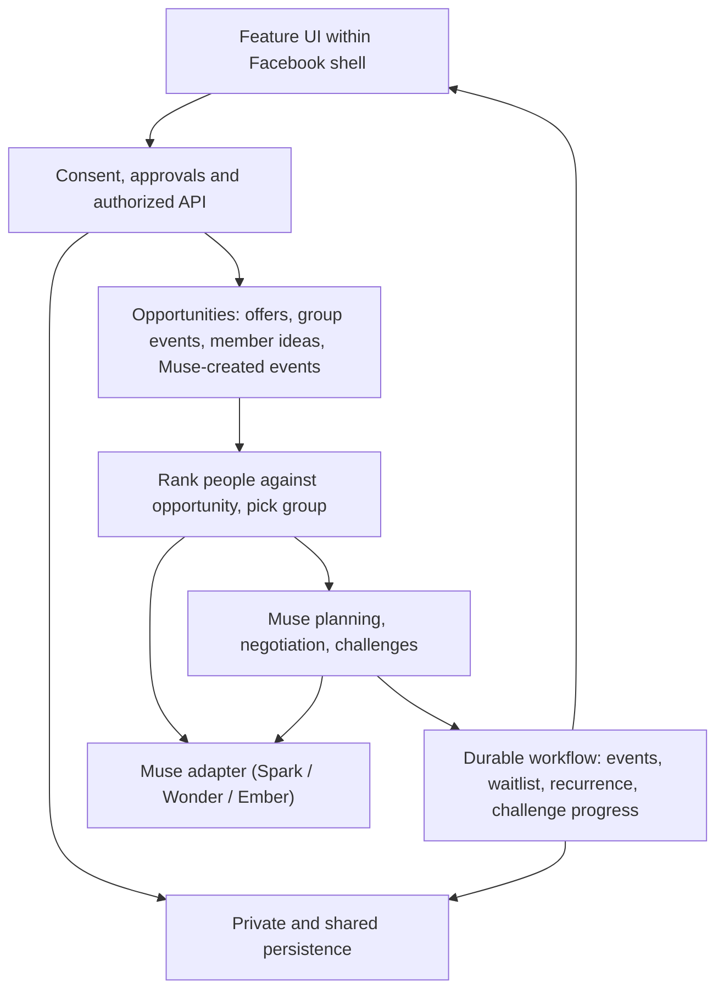

# Group Quests
### From joining a group to belonging in one.

An AI social coordinator for Facebook that turns the communities young adults already belong to into small groups that actually meet, adapt and keep showing up. Powered by Muse.

**Current state:** this repository contains the existing Facebook-style mock frontend, shared contracts, a FastAPI server baseline (`server/app/`), and early owner modules (for example `server/privacy/` and `server/matching/`, verified with fixtures). The end-to-end Group Quests journey is not yet live. A specification is not evidence of a working journey, live Muse integration, authentication or real Facebook access. See [PROJECT_KNOWLEDGE.md](PROJECT_KNOWLEDGE.md) for the evidence ledger.

## Start here
**Coding agents: use the [execution map](docs/phases/README.md), then follow your own phased checklist.** Each phase names the work, starting paths, upstream dependencies, exit evidence and downstream handoff.

| Your owner | Your build plan | Your branch |
| --- | --- | --- |
| Rishi | [P0-P6: opportunity matching](docs/phases/rishi.md) | `role/rishi-matching` |
| Adam | [P0-P6: Muse planning, negotiation and challenges](docs/phases/adam.md) | `role/adam-planning` |
| Will | [P0-P6: onboarding and feature UI](docs/phases/will.md) | `role/will-voice-ui` |
| Patrik | [P0-P6: privacy and approvals](docs/phases/patrik.md) | `role/patrik-privacy` |
| Kai | [P0-P6: durable workflow](docs/phases/kai.md) | `role/kai-orchestration` |

1. Read [AGENTS.md](AGENTS.md), the common entry point for every coding agent.
2. Read [PROJECT_KNOWLEDGE.md](PROJECT_KNOWLEDGE.md) for current facts and open decisions.
3. Read [contracts/README.md](contracts/README.md) and [contracts/protocol.ts](contracts/protocol.ts).
4. Read your assignment in [docs/roles](docs/roles) and your handoff in [docs/handoffs](docs/handoffs).
5. Switch to your assigned remote branch before making changes.
6. Inspect current code and handoffs, implement your first incomplete deliverable, verify it, and publish the next handoff. Use a test-only adapter instead of waiting on another owner.

Phases: **P0 setup, P1 independent systems, P2 integration, P3 live adaptation, P4 keep-it-going and challenges, P5 stabilization, P6 UI/demo.** The final six hours are reserved for polish, demo, video and submission.

## Product boundary
The existing `web/` application is the **mock Facebook shell**. Build on it, but give Group Quests its own feature UI under `web/src/features/group-quests/`, one subdirectory per owner. Will owns route and navigation integration (proposed entry `/groups/:communityId/quests`). Keep feature CSS scoped. Do not redesign the feed or treat its mock users, chats and localStorage as the product backend.

## The problem
Young adults join Facebook Groups for a new city, a new campus or a new hobby, and then nothing happens. Meeting people from a group means someone has to take the initiative: pick an activity, find a time, guess what others can afford, post it, and risk nobody showing up. Most people don't want to be that person, so plans die in the group chat. When a meetup does happen, it is usually a one-off. No one organizes the second one.

Existing apps (Timeleft, 222, Pie, Bumble Plans) show the demand is real. They get strangers into one room. The gap we target is different: **taking the initiative on everyone's behalf inside communities people already joined, adapting when plans change, and keeping the same small group coming back.**

## Our solution
Muse acts as each member's agent. Members say what they're comfortable with, not what they want to organize. Muse finds or creates the plan, forms the group, handles the logistics, rescues the plan when someone drops, and gives the group a reason to meet again.

## One complete journey
1. **Opt in from a Group.** A member joins Group Quests from a Facebook Group they already belong to.
2. **Share preferences, not a plan.** By voice or quick taps, they give their schedule, budget, energy level, social comfort and interests. They don't pick an activity. If the input is vague, Muse asks one follow-up question. The member confirms the extracted profile.
3. **Muse finds or creates the opportunity.** Muse looks for quests from three sources: venue offers, existing group events and member ideas. **When nothing that exists fits, Muse creates a new event itself**, using approved public venues and the group's shared constraints. Members don't need to have asked for the same thing.
4. **Muse picks the group.** Code filters members by hard constraints (time, budget ceiling, area, consent, group size 3-5). Muse then ranks people against the opportunity and picks the group most likely to enjoy it together, with an allowlisted explanation.
5. **Pitch and approve.** Each member sees a pitch card and taps to approve. Nothing is booked and no money is committed without each person's approval.
6. **Event and chat.** Once enough members approve, the server creates one persistent in-app event and a group chat. Muse posts the opener.
7. **Supporting: venue deal.** Where a venue is involved, Muse can negotiate on the group's behalf with the venue's business assistant on Messenger. The venue sees only group size, time and the group's total budget, and code enforces every member's budget ceiling. In this prototype, venue businesses are simulated and labeled.
8. **Live adaptation.** If someone drops out or availability changes, Muse fills the spot from a waitlist, re-plans, or renegotiates. Members reconfirm any material change.
9. **Retention: challenges.** After every meetup, Muse gives the group a personalized challenge with an incentive to meet again. Simulated rewards are labeled.
10. **Keep it going.** One tap makes the quest recurring, and Muse keeps organizing it. The next-week time skip in the demo is simulated and labeled. Muse's reasoning after the skip runs live.

**Example:** four students who just transferred to the same university are all in its transfer-students Group. None of them asked for climbing.
- One says "low-key, under $15, Saturday afternoon".
- One says "want to try something new, not a bar".
- One says "active, but I'm a beginner".
- One says "anything, I just want to meet people".

A local bouldering gym posts an off-peak opening. Muse sees that it fits all four and pitches it. All four approve, and the event and group chat appear. As a supporting step, Muse negotiates a group intro rate within everyone's ceiling. On Friday one member drops, and a waitlisted member fills the spot. After the climb, Muse sets a challenge: send your first V2 together within three sessions (simulated reward). One tap makes it every other Saturday.

If no gym had posted anything, Muse would have created the event itself from the approved venue catalog.

## Why Facebook, and why AI
Facebook already has the communities, the trust of an existing Group, Events and Messenger. Group Quests uses them instead of asking people to rebuild their social graph in a new app. This prototype simulates that integration; we claim no Groups or Messenger API access.

AI is essential, not decorative:
- **Interpreting open-ended preferences.** Muse turns "something chill, not a bar" into a structured profile.
- **Matching people to opportunities.** People who wanted different things can still fit the same opportunity.
- **Creating events.** When nothing that exists fits, Muse creates one.
- **Acting as the user's agent.** Muse talks to the business's agent on Messenger to negotiate.
- **Adapting.** Muse re-plans live when someone drops out or changes availability.
- **Retention.** Muse generates challenges that bring the group back.

Deterministic code enforces eligibility, authorization, budget ceilings, time intersections, group size, approvals and persistence. Muse proposes; the server validates and executes.

**Model:** the core AI must run on a Muse model: **Spark, Wonder or Ember**. This is a hard Devpost requirement. Display the actual model metadata in the UI.

**Matching baseline:** interest keywords matched to an opportunity, with the same hard constraints. Muse ranking is evaluated against this baseline. Do not claim improvement without a measured live result.

## How we differ
| Capability | Timeleft / 222 / Pie / Bumble Plans | Group Quests |
| --- | --- | --- |
| Algorithmic or AI group matching | Yes | Yes |
| Activities with strangers | Yes | Yes |
| Built into existing Facebook communities | No | Proposed |
| Muse creates an event when none fits | Not established | Proposed |
| Adaptive re-planning and waitlist refill | Not established | Proposed |
| Same group meeting again, with challenges and recurring quests | Some reconnect features | Core proposed experience |
| Agent-to-business negotiation within member budgets | Not established | Supporting feature |

These are our proposed differentiators. We have not verified that no competitor offers them.

## Architecture


Frontend: the existing React, TypeScript, Vite, React Router and Tailwind shell. Server: Python/FastAPI (`server/app/`, Python 3.11+). Each owner registers one router through `server.app.registry`. See [architecture](docs/ARCHITECTURE.md) and [server/app/README.md](server/app/README.md).

## Five engineering owners
| Owner | Branch | System | Owned paths |
| --- | --- | --- | --- |
| Rishi | `role/rishi-matching` | Ranks people against opportunities, picks the group, hard-constraint filtering, baseline evaluation | `server/matching/`, `web/src/features/group-quests/matching/`, `tests/matching/` |
| Adam | `role/adam-planning` | Muse adapter, preference extraction, Muse-created events, negotiation loop and venue personas, re-planning, challenge generation | `server/planning/`, `server/providers/`, `web/src/features/group-quests/planning/`, `tests/planning/` |
| Will | `role/will-voice-ui` | Voice/tap onboarding, feature composition, pitch card, live negotiation view, approve button, keep-it-going button, challenge UI | `web/src/features/group-quests/onboarding/`, `web/src/features/group-quests/shell/`, `server/voice/`, `tests/onboarding/` |
| Patrik | `role/patrik-privacy` | Auth, consent, private projections; venue sees group totals only; no money committed without approval | `server/privacy/`, `db/privacy/`, `web/src/features/group-quests/privacy/`, `tests/privacy/` |
| Kai | `role/kai-orchestration` | Opportunity store, deduplicated venue holds, waitlist, events and chat, recurring quests, challenge progress, real-time updates | `server/orchestration/`, `server/app/`, `db/workflow/`, `web/src/features/group-quests/events/`, `tests/orchestration/` |

All five own substantial product systems and relevant UI. Presentation work is shared at freeze. It is not a substitute for technical ownership.

Shared files require producer/consumer agreement: `contracts/`, database migration order, dependency manifests, root routing and cross-system API registration. Will coordinates web routing and package changes. Kai coordinates server composition and migration ordering. Patrik reviews authorization boundaries. Adam owns the single Muse adapter.

## Local setup
```sh
git clone https://github.com/willapat/Meta-Hackathon.git
cd Meta-Hackathon
git fetch origin
git switch --track origin/role/rishi-matching   # substitute your branch
```

Frontend shell (from `web/`, Node 22.12+):
```sh
npm ci
npm run dev
npm run lint && npm run build && npm run test:e2e
```
Playwright may need `npx playwright install chromium`. The existing e2e tests exercise the mock shell, not the feature.

Server baseline: follow [server/app/README.md](server/app/README.md) (venv, `requirements-dev.lock`, `uvicorn server.app.main:app`). `GET /health/ready` returns 503 until all five owners register. A running process is not evidence of a working journey.

## Configuration
Server-only configuration includes the Muse API key, the Muse model (Spark, Wonder or Ember), the provider URL confirmed by organizers, database credentials and session settings. Use the placeholders in [server/app/.env.example](server/app/.env.example); real credentials stay outside Git. Only public settings such as a backend base URL may use Vite's client-exposed prefix.

## Contracts
Current shared contract: **1.0.0** ([protocol.ts](contracts/protocol.ts)).

The new direction requires these types, **proposed for contract 1.1.0 and not yet agreed**:
- `PreferenceProfile`: schedule, budget ceiling, energy, social comfort and interests; replaces the activity-specific intent.
- `Opportunity`: a venue offer, existing group event, member idea or Muse-created event.
- `VenueOffer` / `Counteroffer`: negotiation messages carrying group totals only.
- `Deal`: an agreed offer awaiting member approval.
- `Challenge` / `Reward`: a post-meetup challenge with progress; rewards are labeled as simulated.

Each type lands only with an entry in [docs/DECISIONS.md](docs/DECISIONS.md), acknowledgment from producer and consumers, runtime validators and examples.

- [Wire protocol and service methods](contracts/README.md)
- [State machine and event semantics](contracts/WORKFLOW.md)
- [Access matrix](contracts/PRIVACY.md)
- [HTTP surface](contracts/API.md)
- [Architecture](docs/ARCHITECTURE.md) · [Plan](docs/PLAN.md) · [Demo and Q&A](docs/DEMO.md) · [Agent launch prompts](docs/START_HERE.md)

Update your own handoff and log at each checkpoint. Open small PRs to main; the PR owner's human merges them. No force pushes to main or to teammates' branches.

## Truth labels and fallback behavior
| Item | Demo requirement |
| --- | --- |
| Facebook shell / integration | Simulated, clearly labeled |
| Seed profiles | Synthetic, explicitly labeled; cannot stand in for real judge acceptance |
| Venue businesses and their assistants | Simulated, clearly labeled |
| Rewards attached to challenges | Simulated, clearly labeled |
| Real judges and teammates | Opt-in sessions with real persisted actions |
| Muse matching, event creation, negotiation, challenges | Live validated responses showing actual model metadata (Spark, Wonder or Ember) |
| Time skip / dropout fixture | User-triggered simulation; the reasoning that follows runs live |
| Cached provider response | Labeled replay of its original saved scenario |
| Database event creation | Real in-app persistence; never called a real Facebook Event |

Typing and quick taps always work if the microphone fails. If no opportunity or group fits, Muse creates an event or explains the no-fit state honestly. Never silently relax consent, capacity, time, location or budget constraints. A provider outage returns a retryable error or an explicitly labeled replay.

## Privacy and behavior
- Voice, transcripts and personal constraints are private.
- Only consented, minimized structured fields enter model requests. Prompts never receive session tokens, contact details or home addresses.
- **The venue sees only group size, time and the group's total budget.** It never sees individual budgets or identities.
- **Code enforces each person's budget ceiling.** A deal above any member's ceiling is rejected regardless of what Muse proposes.
- **No booking or money commitment without each member's explicit approval.**
- Public explanations use allowlisted interests and activity details and are validated before publication.
- Groups have 3-5 people, public venues by default, explicit approval, leave controls, and reconfirmation after material changes.
- Model output cannot authorize itself or bypass server guards.

## Acceptance targets
- Three real participants can join from separate devices.
- Time from confirmed preferences to an approved quest is measured. The target is under 60 seconds; this is a target, not an achieved claim.
- Every proposed group satisfies the hard constraints.
- When no existing opportunity fits, Muse creates a valid event from approved venues.
- Negotiation never produces a deal above any member's budget ceiling.
- Nothing is booked without each member's approval.
- Duplicate approvals and job retries create only one event and one venue hold per quest.
- A dropout is refilled from the waitlist, or the group gets an honest re-plan or no-plan result.
- The group receives a challenge after the meetup.
- Keep-it-going creates a recurring quest.
- Unauthorized participants cannot read private profiles or group messages.
- All fixture, replay and simulated states are labeled.

No sign-up, friendship, loneliness or retention impact is claimed without measurement.

## Pitch (30 seconds)
Joining a Facebook Group is easy. Actually meeting people from it almost never happens, because someone has to take the initiative, and nobody wants to be that person. Group Quests makes Muse that person. Tell it your schedule, budget and comfort level by voice or a few taps. Muse finds an opportunity, or creates one, picks the few people it fits, and sets up the event and chat once you approve. If someone drops, it fills the spot. After you meet, it gives your group a challenge to come back, and one tap keeps it going every week. Facebook already has the communities. Group Quests turns them into small groups that actually meet, adapt and keep showing up.

## Provenance
The team referenced the documentation organization of dor-calhacks: shared entry instructions, contracts, role handoffs and an evidence ledger. This project is newly authored; no prior hackathon application code was copied. Competitor references (Timeleft, 222, Pie, Bumble Plans) come from team research and are used for positioning only.
