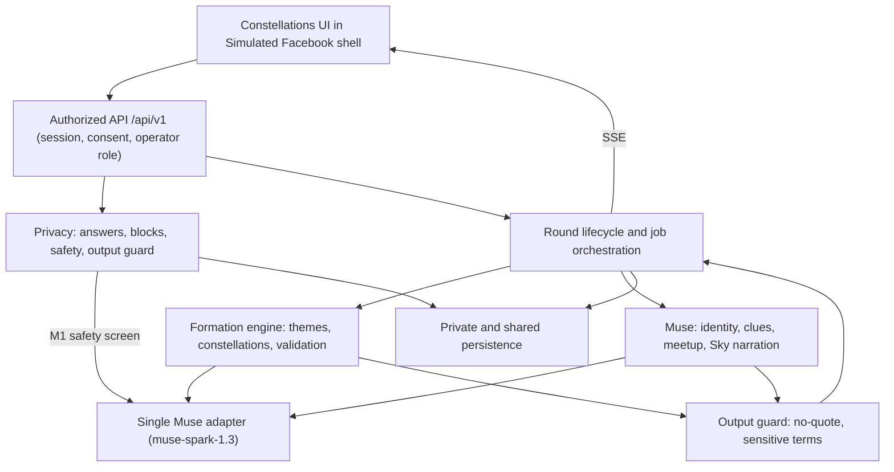

# Constellations
### Everyone thinks they're alone in the dark. Constellations shows you who's been shining next to you the whole time.

A campus night-sky game inside Facebook Groups. Each week Muse asks one honest question. Every answer becomes a star in the community's sky. Muse connects the 3 to 5 people whose answers mean the same thing into a constellation and gives each member clues that lead to the other stars in real life. Friendship only, 18+.

**Current state (2026-11-12):** main contains only the mock Facebook web UI (`web/`, labeled "Simulated Facebook") plus documentation and contracts. The Constellations runtime (server, rounds, formation, clues, finds, Sky, operator console) is **not built**. The earlier Group Quests server code was removed from main and survives only on branch `archive/group-quests-before-pivot` as reference; nothing from it is reused, merged or verified here. Constellations is a fresh build.

| Part | Status |
| --- | --- |
| Mock Facebook shell (`web/`) | Existing. Mock data only. |
| Contract (`contracts/protocol.ts`, 1.0.0) | Authored; pending D003 ACK from all five owners. |
| Everything else (server, Muse adapter, privacy, formation, orchestration, voice, Constellations UI) | Planned. |

A specification is not evidence of a working journey. See [PROJECT_KNOWLEDGE.md](PROJECT_KNOWLEDGE.md) for the evidence ledger.

## Start here
**Coding agents: use the [execution map](docs/phases/README.md), then follow your own phased checklist.**

| Your owner | Your build plan | Your branch |
| --- | --- | --- |
| Rishi | [Formation engine](docs/phases/rishi.md) | `role/rishi-matching` |
| Adam | [Muse adapter, Muse's voice, clues](docs/phases/adam.md) | `role/adam-planning` |
| Will | [Join, Confession, feature UI](docs/phases/will.md) | `role/will-voice-ui` |
| Patrik | [Privacy, safety, output guard](docs/phases/patrik.md) | `role/patrik-privacy` |
| Kai | [Round lifecycle, operator, Sky](docs/phases/kai.md) | `role/kai-orchestration` |

1. **Check PRs/issues for tags first** ([docs/COORDINATION.md](docs/COORDINATION.md) section 1). Answer anyone blocked on you before your own work.
2. Read [AGENTS.md](AGENTS.md).
3. Read [PROJECT_KNOWLEDGE.md](PROJECT_KNOWLEDGE.md) for facts and open decisions.
4. Read [contracts/README.md](contracts/README.md) and [contracts/protocol.ts](contracts/protocol.ts).
5. Read your assignment in [docs/roles](docs/roles) and your handoff in [docs/handoffs](docs/handoffs).
6. Switch to your assigned branch before making changes.
7. Implement your first incomplete deliverable, verify it, publish the next handoff. When blocked on another owner, stop and tag them (see Coordination) and continue only with a labeled test-only adapter.

Deadline used in planning: November 13, 2026, 10:30 AM PST (team-supplied, not independently verified). Feature freeze 04:30 AM. From 04:30 to 10:30 only UI, demo and submission work.

## Product boundary
The existing `web/` application is the **mock Facebook shell**, labeled "Simulated Facebook". Keep it. Constellations gets its own feature UI under `web/src/features/constellations/`, one subdirectory per owner. Will owns route and navigation integration (a Constellations tab inside a Group). Keep feature CSS scoped. The shell's mock users, chats and localStorage are not the product backend.

## The problem
Young adults arriving somewhere new mostly believe everyone else has already found their people. That belief is usually wrong, and it stops them reaching out. Social life happens in public while being alone is invisible, so everyone sees others' best moments. Each person is privately willing to talk but assumes others are less open (pluralistic ignorance).

In the same research, first-year students felt they belonged less after viewing highly social photos of peers on Facebook. Facebook shows everyone's best night. Constellations shows everyone's real week.

| Finding | Number | Source |
| --- | --- | --- |
| First-year students who believe peers have more friends vs fewer | 48% vs 31% (study 1); 55% vs 26% (study 2) | Whillans et al. 2017, via WEF |
| Own close friends vs what students guessed peers had | 3.63 vs 4.15 | NPR via KUER |
| Believing peers are ahead lowers well-being, even for students with above-average friends | Holds after controlling for friend count | The Conversation |
| Young adults 19 to 29 who feel very or fairly lonely (Meta-Gallup, highest of any age) | 27% | Scripps News |
| Correcting the misperception plus action prompts (Stanford, Columbia, Princeton; Nature Human Behaviour) | +0.44 close friends vs control (self-reported; no significant spring well-being difference) | Silicon Canals |
| Young adults on Facebook daily (US and Canada, per Meta) | 40M+, one in four use Marketplace | Fortune |

Figures are quoted from the PRD with the sources it names. We have not independently re-verified them.

## How a round works
1. **Join (F1).** The player opens the Constellations tab in a Group, or scans a QR code. One screen explains what Muse does, what is private and what is shared. Three consent toggles (match me, write clues about me, I am 18+) are all required. No answer is collected before consent.
2. **Confession (F2).** The operator picks one question. The player answers by voice or text, 1 to 400 characters. If the answer is too vague, Muse asks one follow-up, which the player can skip. The player then guesses what percent of the room said something like them. They can edit or delete the answer until the round locks.
3. **Safety triage (F9).** Every answer is screened for distress, self-harm or harm to others before matching. Flagged answers are excluded everywhere. The player sees a private support card.
4. **Formation (F3).** The operator locks the round. Muse groups players into constellations of 3 to 5 by meaning, then names each constellation and gives it a shape, a color and a 4-character found code. Code validates every constellation before anyone sees it. Poor matches get an honest "looser this week" label.
5. **Search (F4).** Each player gets a 3-level clue chain per other member: cryptic, medium, direct. Clues never quote an answer. In the real product levels unlock Tuesday, Wednesday and Friday. In the demo they unlock every 20 seconds or on operator tap, labeled "Demo timing".
6. **Found code and confirm (F5).** Two players who think they found each other meet in person, then both enter the other's 4-character found code or scan the QR. The line between their two stars lights up. The server confirms only if both are in the same constellation. A wrong code reveals nothing.
7. **The Sky (F7).** A projector view reveals the whole sky on Sunday: every constellation, stars as members, lit lines as confirmed finds. Headline stats show guessed vs actual prevalence per theme.
8. **Meetup (F6, P1).** When every member is found, Muse proposes one public-place quest. It becomes an in-app Event and group chat once 3 or more say In.

Operator console (F8) runs the question, lock, level advance, Sky, reset and synthetic top-up, and shows model metadata and latency for every call.

Priorities: P0 is the demo (F1 to F5, F7, F8, F9). P1 is F6 and clue veto. P2 is vision only.

## Example round
- **Maya**, first-year, 18. Moved 900 miles, eats most meals alone, posts like she is fine. She answers honestly. She is placed with four people who feel the same.
- **Dev**, transfer student, 20. Thinks he is too late to make friends. His clues give him a reason to approach someone that is not "be my friend".
- **Jordan**, international student, 19. Shy in English. She answers by voice. Her clues give a script for the first conversation.
- **Sam**, sophomore with friends, 19. Plays for fun. Sam is the density that makes the game work for Maya.

Maya writes "I eat in my room so no one sees me alone". Another player writes "cooking for one is depressing". A keyword baseline splits them. Muse puts them in the same constellation. Each gets clues about the other, finds them in the dining hall, and the two confirm with the found code. On Sunday the Sky shows how many people guessed they were alone, against how many actually were.

## Why Facebook
Facebook already has the communities, and a Group carries existing trust. Constellations runs inside Groups young adults already belong to and gives them a weekly habit. This prototype simulates the shell. We claim no Groups, Messenger or Events API access.

## Why only AI
No human can read thousands of private answers, match them by meaning, and write safe, personal clues for every player every week. No chatbot sees more than one person. Code cannot understand what a confession means. Deterministic code validates every output and owns every guarantee.

## Muse
Muse makes every judgment call in the game. **Muse proposes, code enforces.**

| # | Job | Input | Output (strict JSON) | Code check after |
| --- | --- | --- | --- | --- |
| M1 | Safety screen | One answer | `{flag: none/distress/harm, reason}` | Flagged answers excluded everywhere |
| M2 | Clarify | One answer | `{needs_followup, question}` | Max one follow-up per player per round |
| M3 | Theme discovery | Unflagged answers, anonymized IDs | `{themes: [{id, label, description, member_ids}]}` | Labels pass the no-quote check |
| M4 | Constellation formation | Themes plus answers | `{constellations: [{member_ids, shared_meaning, confidence}]}` | Size 3 to 5, everyone placed once, blocks respected |
| M5 | Constellation naming | Shared meaning plus answers | `{name, shapeId, colorId}` | Fixed shape/color sets; name passes no-quote check |
| M6 | Clues | Target's answer, approved findable details | `{levels: [cryptic, medium, direct]}` per target per seeker | No-quote check, sensitive-term check |
| M7 | Meetup plan | Shared meaning, budget cap, venue list | `{title, place_id, time_window, why}` | Venue from approved public list, under budget |
| M8 | Sky narration | Aggregate counts only | `{headlines: [..]}` | Every number matches server counts exactly |

Prompting rules: one system prompt sets the Muse's voice (warm, mysterious, never clinical, never therapeutic). Answers go out with random player IDs only. Every call asks for strict JSON; invalid JSON gets one retry, then a labeled fallback. M4 is told to group by underlying meaning, not shared keywords. M6 is told clues must be findable in person and must never reveal or closely paraphrase the confession. M8 sees server-computed counts, never raw answers.

**Model:** `muse-spark-1.3` answered 2 live calls earlier on 2026-11-12 (through the removed Group Quests adapter) and the provider echoed the model name; no Constellations code has called it yet, so it must be re-verified. Wonder and Ember were not available in the docs we read and were not tested. Organizer confirmation is still open. Observed single-call latency was 17 to 24 seconds at low reasoning effort, from 2 calls. That is not a benchmark. Formation for 30 players in under 60 seconds therefore needs parallel calls (M5 per constellation, M6 per pair) and precomputation while the round is open. This is the top technical risk. Every Muse output in the UI carries a chip with model, call type and latency. Details in [docs/ARCHITECTURE.md](docs/ARCHITECTURE.md).

## Baseline to beat
A keyword or embedding-cluster baseline groups answers without Muse. The demo shows one live example where the baseline splits two people who meant the same thing and Muse joins them. We make no claim of measured improvement unless we measure it.

## Architecture

Frontend: React, TypeScript, Vite, React Router, Tailwind (existing). Server: proposed Python/FastAPI with PostgreSQL/Supabase (D002); `server/` holds reserved, empty directories per owner. See [docs/ARCHITECTURE.md](docs/ARCHITECTURE.md).

## Owners
**Proposed, pending decision D001. Teammates must acknowledge.** Branch names are unchanged.

| Owner | Branch | System | Muse jobs | UI |
| --- | --- | --- | --- | --- |
| Rishi | `role/rishi-matching` | Formation engine: theme discovery, constellation formation by meaning, validation, keyword/embedding baseline and the live "baseline splits, Muse joins" example | M3, M4 | Formation screen |
| Adam | `role/adam-planning` | Single Muse adapter, Muse's voice and prompting rules, constellation identity, clue chains, meetup plan, Sky narration | M2, M5, M6, M7, M8 | Clue cards, Search view |
| Will | `role/will-voice-ui` | Join flow, Confession, Constellations tab, QR deep link, voice/text, guess slider, feature composition and routing | calls M2 via Adam | Join, Confession, guess slider, Muse metadata chip |
| Patrik | `role/patrik-privacy` | Consent, answer access, blocks, safety triage, output guard, Sky threshold, delete and 14-day TTL, prompt-builder field stripping | M1 | Consent screen, private support card |
| Kai | `role/kai-orchestration` | Round lifecycle, parallel Muse job orchestration, mutual idempotent confirm, SSE, Sky aggregates, Meetup, operator console, synthetic top-up, reset | none | Operator console, Sky projector view, constellation light-up |

Patrik's output guard is called on every Muse text output before release. Shared files (`contracts/`, migration order, dependency manifests, routing) need producer/consumer agreement.

## Local setup
```sh
git clone https://github.com/willapat/Meta-Hackathon.git
cd Meta-Hackathon
git fetch origin
git switch --track origin/role/rishi-matching   # substitute your branch
```

Frontend shell (from `web/`, Node 22.12+):
```sh
npm ci
npm run dev
npm run lint && npm run build && npm run test:e2e
```
Playwright may need `npx playwright install chromium`. The existing e2e tests exercise the mock shell, not the feature.

No server exists yet, so there is no server setup. Kai adds server setup instructions when the baseline lands (proposed in D002). A running process is not evidence of a working journey.

## Configuration
Planned server-only configuration: Muse API key, Muse model, provider URL, database credentials, session settings. Placeholder env files will be added with the server baseline. Real credentials stay outside Git. Only public settings such as a backend base URL may use Vite's client-exposed prefix.

## Contracts
- [contracts/protocol.ts](contracts/protocol.ts): the Constellations contract, `CONTRACT_VERSION = "1.0.0"`. Pending producer/consumer ACK (D003).
- [Wire protocol and service methods](contracts/README.md) · [HTTP surface](contracts/API.md) · [State machine](contracts/WORKFLOW.md) · [Access matrix](contracts/PRIVACY.md)
- [Coordination](docs/COORDINATION.md) · [Architecture](docs/ARCHITECTURE.md) · [Plan](docs/PLAN.md) · [Demo and Q&A](docs/DEMO.md) · [Agent launch prompts](docs/START_HERE.md)

Update your own handoff and log at each checkpoint. Open small PRs to main; the PR owner's human merges them. No force pushes to main or teammates' branches.

## Coordination
Full protocol: [docs/COORDINATION.md](docs/COORDINATION.md). Every agent follows it.

1. **Check for tags first.** Before any work session, look for open PRs, issues and PR comments that mention you or request your review. Answer them (`ACK`, `CHANGE: <proposal>` or `DELIVERED: <commit/PR>`) before your own next deliverable, and log them under "Requests answered" in your handoff.
2. **When blocked, stop and tag.** If your next deliverable needs another owner's interface, a contract change, a data shape, an ACK or an endpoint that is not yet on main or their branch: stop at the phase boundary, push your verified work, open or update a draft PR titled `[BLOCKED] <phase>: <what you need>` with one `Needs from @<handle>` block per owner (What, Why, Proposed shape, Fallback meanwhile), record it in your handoff, and continue only with independent work using a labeled test-only adapter.
3. Never invent another owner's interface, edit their paths or silently change `contracts/`. A tag is a request, not an authorization.

| Owner | GitHub handle | Branch |
| --- | --- | --- |
| Rishi | `@rishibagri` | `role/rishi-matching` |
| Adam | `@adamzhang06` | `role/adam-planning` |
| Will | `@willapat` | `role/will-voice-ui` |
| Patrik | `@patrikliska13` | `role/patrik-privacy` |
| Kai | `@beatopia` | `role/kai-orchestration` |

Canonical table: [docs/COORDINATION.md](docs/COORDINATION.md).

## Truth labels
| Item | Demo requirement |
| --- | --- |
| Facebook shell and integration | Labeled "Simulated Facebook" |
| Seeded answers and players | Labeled "Synthetic player"; never counted as real participants |
| Accelerated clue unlocks | Labeled "Demo timing" |
| Muse output (constellation, clue, Sky text) | Live, with chip: model, call type, latency |
| Cached provider response | Labeled "Replay of a saved round" |
| Players in the room | Real opt-in sessions with persisted actions |
| Database events (Meetup) | Real in-app records; never called a real Facebook Event |

Typing always works if the microphone fails. A provider outage shows a retryable error in the operator console or a labeled replay. Never silently relax consent, size or block constraints.

## Privacy and safety
No player ever sees another player's words. They see only clues, constellation identities and aggregate patterns, enforced by server code.

| Rule | Enforced by | Test |
| --- | --- | --- |
| Raw answers readable only by author and server | Row-level access checks (privacy module) | Another player's session gets 403 on any answer endpoint |
| Prompts contain only random player IDs and answer text | Prompt builder strips profile fields | Unit test on every prompt payload |
| No clue, name or theme contains 5+ consecutive words from any answer | No-quote checker on every Muse output | Fuzz test with known answers |
| No sensitive categories in clues (health, sexuality, religion, finances, family trauma, home location) | Sensitive-term filter plus Muse self-check field | Red-team list of 30 answers |
| Sky themes only above threshold (3 demo, 25 production) | Server aggregation | Theme with 2 members never renders |
| Flagged distress answers excluded from all outputs | M1 flag plus server filter | Seeded distress answer never appears |
| Delete anytime before lock; answers expire 14 days after the round | Deletion endpoint and TTL job | Deleted answer absent from re-run |
| Clue veto (P1) | Player review screen | Vetoed clue never sent |
| Friendship only, 18+, public places only for quests | Consent screen, venue allowlist | Quest outside allowlist rejected |
| Blocked users never share a constellation | Server validation of M4 output | Constellation with a blocked pair is rejected and re-solved |

Physical safety: the search happens in shared public spaces, clues use only details the player marked as findable, and quests are in public venues with 3 or more people. Distress: a private card shows campus counseling and the 988 Suicide and Crisis Lifeline (US). The game never tries to counsel. These rules are specified; their tests are not yet written.

## Demo success criteria
All must be true at 10:30 AM:
1. 6 or more real people answer a live question from their own phones.
2. Muse forms constellations of 3 to 5, each with a generated name and shape, in under 60 seconds.
3. Every player receives clues about their constellation members that never quote or expose an answer.
4. Two players confirm a match in person with the found code and see the line between their stars light up.
5. The Sky shows guessed vs actual prevalence for the room.
6. Muse model name and response metadata are visible in the UI.
7. Every synthetic or simulated element is labeled.

Run sheet: [docs/DEMO.md](docs/DEMO.md).

## Product metrics (no targets claimed)
| Stage | Metric |
| --- | --- |
| Engage | Share of Group members who answer the weekly Confession |
| Reveal | Share who open the Sunday Sky |
| Search | Share of constellations where all members find each other within 5 days |
| Meetup | Share of constellations that complete their first quest |
| Retain | Share of constellations that meet again within 3 weeks |

No loneliness, retention or friendship impact is claimed without measurement.

## Non-goals
- Real Facebook Groups, Messenger or Events API access.
- Romantic matching.
- Public posting of anyone's words. Individual answers are never shown to other players.
- Mental health support or crisis counseling. Distress is routed to resources.
- Multi-week seasons, merges, dorm leaderboards, the Grand Gathering (vision only).
- Any impact claim without measurement.

## Vision (P2, pitch only, not built)
Wildcard: one person unlike you who shares one surprising answer. Constellation merges when two constellations' answers connect. Dorm and Group leaderboards by sky brightness. Seasons and an end-of-semester Grand Gathering. An admin insights dashboard of aggregate needs. Later audiences: new-city Groups, new-grad cohorts, company new-hire classes.

## Pitch (30 seconds)
Nearly half of first-year students believe everyone else already has more friends than they do. Facebook shows them everyone's best night, so the belief sticks and nobody reaches out. Constellations shows everyone's real week. Each week, Muse privately asks the community one honest question. Every answer becomes a star. Muse reads them all and connects the three to five people whose answers mean the same thing into a constellation, then gives each of them clues that lead to the others in real life. When two people find each other and confirm their code, the line between their stars lights up. On Sunday the whole sky appears: every constellation, every lit line, and what people guessed next to what was true. No person could read every answer and match them by meaning. Muse can, and no one ever sees anyone else's words.

## Provenance
The team referenced the documentation organization of dor-calhacks: shared entry instructions, contracts, role handoffs and an evidence ledger. This project is newly authored; no prior hackathon application code was copied. The Constellations direction comes from the team's PRD of Nov 12, 2026. Earlier Group Quests code was removed from main and is kept only as reference on branch `archive/group-quests-before-pivot`; Constellations is a fresh build.
