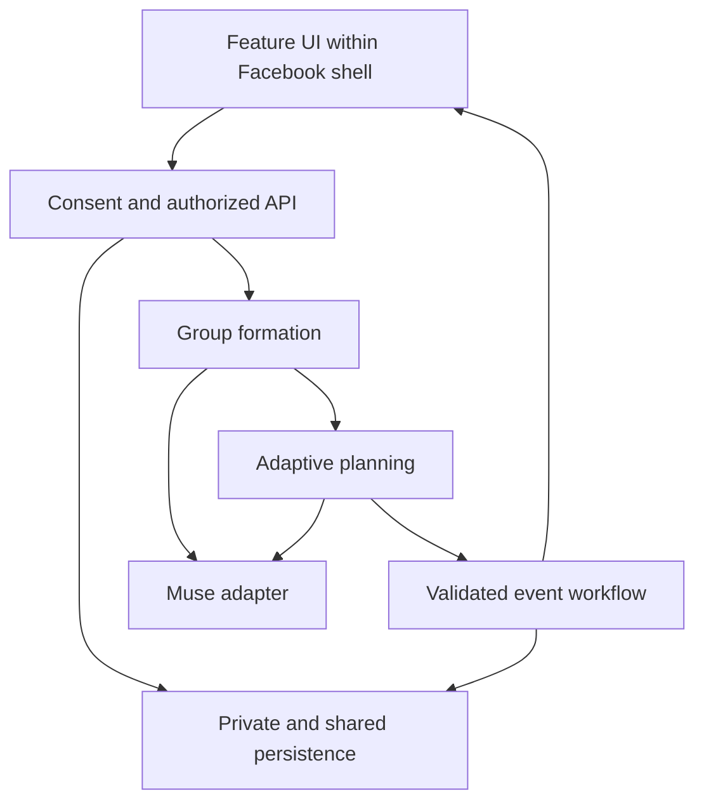

# Group Quests
### From joining a group to belonging in one.

A hackathon feature for Facebook that helps young adults form small teams, do something together, and return with a reason to reconnect. A voice note becomes a confirmed intent, a compatible group, a shared quest, and a plan that adapts when participants' circumstances change.

**Current state:** this repository contains an existing Facebook-style mock frontend plus shared engineering instructions and contracts. The Group Quests runtime is to be implemented. A specification is not evidence of a working backend, Muse integration, authentication, or real Facebook access.

## Start here
**Coding agents: use the [execution map](docs/phases/README.md), then follow your own phased checklist below.** Each phase names the work, starting paths, upstream dependencies, exit evidence and downstream handoff.

| Your owner | Your build plan | Your branch |
| --- | --- | --- |
| Rishi | [P0-P6: group recommendation](docs/phases/rishi.md) | `role/rishi-matching` |
| Adam | [P0-P6: adaptive planning](docs/phases/adam.md) | `role/adam-planning` |
| Will | [P0-P6: voice interaction and feature composition](docs/phases/will.md) | `role/will-voice-ui` |
| Patrik | [P0-P6: privacy and access](docs/phases/patrik.md) | `role/patrik-privacy` |
| Kai | [P0-P6: reliable events](docs/phases/kai.md) | `role/kai-orchestration` |

1. Read [AGENTS.md](AGENTS.md), the common entry point for every coding agent.
2. Read [PROJECT_KNOWLEDGE.md](PROJECT_KNOWLEDGE.md) for current facts and open decisions.
3. Read [contracts/README.md](contracts/README.md) and [contracts/protocol.ts](contracts/protocol.ts).
4. Read your named assignment in [docs/roles](docs/roles) and your handoff in [docs/handoffs](docs/handoffs).
5. Switch to your assigned remote branch before making changes.
6. Inspect the current code and handoff, choose the first incomplete task in your phased checklist, implement it, verify it, and publish the next handoff. Do not wait for other owners when a test-only adapter can unblock independent work.

Phases: **P0 setup (H0-1), P1 independent systems (H1-4), P2 integration (H4-7), P3 live adaptation (H7-10), P4 return/hosting (H10-13), P5 stabilization (H13-16), P6 UI/demo (H16-22).** The final six hours remain reserved for polish, demo, video and submission.

Paste this into your agent, substituting your name:

> I am NAME. Read AGENTS.md, docs/phases/README.md, docs/roles/NAME.md, docs/phases/NAME.md and docs/handoffs/NAME.md plus the shared contracts. Confirm my role branch and inspect current progress. Implement my first incomplete phase deliverable within my owned paths, run relevant checks, and update my handoff with exact evidence and the next consumer action. Continue independent work if an upstream dependency is blocked. Preserve the mock Facebook shell and build our feature UI in its separate area.

Already on a role branch? Fetch and merge `origin/main` from a clean working tree to receive shared plan updates. A new main commit does not automatically update your branch.

## Product boundary
The existing `web/` application is the **mock Facebook shell**. Build on it, but give Group Quests its own feature UI. Do not redesign the feed or treat its mock Facebook cards, people, chats, and localStorage as the live product backend.

Reserve `web/src/features/group-quests/` for the feature. Each owner has a separate subdirectory. Will owns minimal route and navigation integration into the shell, with a proposed entry at `/groups/:communityId/quests`. That route is planned, not registered by this foundation commit. The feature may use its own spacing, layout, and visual language while respecting the surrounding shell. Keep feature CSS scoped. A framework for feature ownership is provided; no final feature design is prescribed.

## The problem
Joining an interest group is easy; initiating an activity and maintaining contact can be awkward. We focus on social belonging, with college communities as an initial setting and support for other young adults. Mentorship, dating, jobs, housing, and nationwide discovery are outside the MVP.

## One complete journey
1. A person enters a community and opts into Group Quests.
2. They record or type a short intent. They confirm the extracted interests, availability, budget, and group preferences.
3. The server filters eligible participants, then Muse selects a feasible team and explains the shared interests.
4. Muse proposes a small activity. Members explicitly accept.
5. Code detects sufficient participation. Muse selects feasible details from approved venues and participant constraints; server validation precedes persistence.
6. The app creates one real in-app event and conversation.
7. A participant changes availability. Muse proposes a revision; affected members reconfirm material changes.
8. A labeled next-week time skip triggers live generation of a continuation. A participant may accept a hosting role and create a draft invitation.

Example: three newcomers share a 20-minute public photo walk and create a three-photo story together. The activity must create interaction, not just aggregate individual points.

## Why Facebook, and why AI
The proposed Facebook integration supplies a community's purpose, consenting members, and event context. This prototype simulates that integration. We make no claim of unrestricted Groups or Messenger API access.

Muse interprets open-ended intent, reconciles different preferences, explains team selection, and revises plans. Deterministic code enforces eligibility, authorization, budgets, time intersections, group size, and persistence. A threshold counter is code, not AI reasoning. The comparison baseline for matching is shared-interest ranking with the same hard constraints.

## Architecture


Use the existing React, TypeScript, Vite, React Router and Tailwind frontend. Proposed server baseline: Python/FastAPI with PostgreSQL/Supabase, subject to the first integration checkpoint. Server packages, database setup and provider clients are not installed by this documentation foundation. Keep transport contracts stable if implementation choices change. See [architecture](docs/ARCHITECTURE.md).

## Five engineering owners
| Owner | Branch | System | Owned paths |
| --- | --- | --- | --- |
| Rishi | `role/rishi-matching` | Group recommendation, constraint filtering, baseline evaluation | `server/matching/`, `web/src/features/group-quests/matching/`, `tests/matching/` |
| Adam | `role/adam-planning` | Muse adapter, intent reasoning, adaptive planning and revisions | `server/planning/`, `server/providers/`, `web/src/features/group-quests/planning/`, `tests/planning/` |
| Will | `role/will-voice-ui` | Voice-to-action interaction, feature composition and timer | `web/src/features/group-quests/onboarding/`, `web/src/features/group-quests/shell/`, `server/voice/`, `tests/onboarding/` |
| Patrik | `role/patrik-privacy` | Authentication, consent, private projections, access controls | `server/privacy/`, `db/privacy/`, `web/src/features/group-quests/privacy/`, `tests/privacy/` |
| Kai | `role/kai-orchestration` | Durable event workflow, transactions, subscriptions and infrastructure | `server/orchestration/`, `server/app/`, `db/workflow/`, `web/src/features/group-quests/events/`, `tests/orchestration/` |

All five own substantial product systems and relevant UI. Presentation work is shared at freeze; it is not a substitute for technical ownership.

Shared files require producer/consumer agreement: `contracts/`, database migration order, dependency manifests, root routing, and cross-system API registration. Will coordinates existing web routing/package changes. Kai coordinates server composition and database migration ordering. Patrik reviews authorization boundaries. Adam owns the single provider adapter used by Rishi and planning.

## Local setup: existing shell
```sh
git clone https://github.com/willapat/Meta-Hackathon.git
cd Meta-Hackathon
git fetch origin
git switch --track origin/role/rishi-matching
# Substitute your branch from the table.
cd web
npm ci
npm run dev
```
If your local branch already exists, use `git switch <branch>` instead. Use the Node version allowed by `web/package.json` (Node 22.12+ is the frontend README's recommendation). Open the URL printed by Vite.

Existing checks, run from `web/`:
```sh
npm run lint
npm run build
npm run test:e2e
```
Playwright may require `npx playwright install chromium`. Existing tests exercise the mock shell, not the future feature. See [web/README.md](web/README.md) for shell details.

There is no root npm application command or backend start command yet. Kai adds reproducible backend setup when its scaffold lands. Never advertise a setup command that does not exist.

## Configuration
Server-only configuration will include `MUSE_API_KEY`, `MUSE_MODEL`, a provider URL confirmed by organizers, database credentials, and session/auth settings. Muse model names and audio support must be verified against supplied access. Do not assume a product called Muse Voice exists. Will owns a transcription adapter if separate STT is necessary.

Only public settings such as a backend base URL may use Vite's client-exposed environment prefix. Never put provider or database service keys there. Commit an example configuration with placeholders when the adapter exists; real credentials stay outside Git.

## Truth labels and fallback behavior
| Item | Demo requirement |
| --- | --- |
| Facebook shell / integration | Simulated, clearly labeled |
| Seed profiles | Synthetic, explicitly labeled; cannot masquerade as judge acceptance |
| Real judges / teammates | Opt-in sessions with real persisted actions |
| Muse generation and matching | Live validated responses; display actual model metadata |
| Time skip / changed attendance fixture | User-triggered simulation; subsequent reasoning runs live |
| Cached provider response | Labeled replay for its original saved scenario |
| Database event creation | Real in-app persistence; never call it a real Facebook Event |

Typing is always available if microphone capture fails. If matching has no feasible result, explain the state and let the user broaden soft preferences or choose another slot. Never silently relax consent, capacity, time, location, or budget constraints. A provider outage returns a retryable error or an explicitly labeled replay.

## Privacy and behavior
Raw voice/transcript and personal constraints are private. Only consented, minimized structured fields enter model requests; prompts must not receive session tokens, contact details, or exact home addresses. Public match explanations use allowlisted interests and activity details. Validate them before publication. Provider requests are external processing, not end-to-end encryption.

Use 3-5 participants per quest, public venue defaults, explicit acceptance, leave controls, and reconfirmation after material plan changes. Model output cannot authorize itself or bypass server guards.

## Contracts and coordination
- [Wire protocol and service methods](contracts/README.md)
- [Type definitions](contracts/protocol.ts)
- [State machine and event semantics](contracts/WORKFLOW.md)
- [Access matrix](contracts/PRIVACY.md)
- [HTTP surface](contracts/API.md)
- [Architecture and integration order](docs/ARCHITECTURE.md)
- [22-hour plan](docs/PLAN.md)
- [Demo and Q&A](docs/DEMO.md)
- [Agent launch prompts](docs/START_HERE.md)

Update your own handoff and log at each meaningful checkpoint. Branch logs only become visible on main after merge; inspect the owner's remote branch for pending work. No force pushes to main or teammates' branches. Use small PRs for implementation after this shared foundation.

## Acceptance targets
- Three real participants can join from separate devices.
- Confirmed intent to accepted quest is timed; target under 60 seconds, not an achieved claim.
- Every proposed group satisfies hard constraints.
- Duplicate accepts and job retries create only one event per quest.
- An availability change produces a feasible revision or an honest no-plan result.
- Unauthorized participants cannot read private intents or group messages.
- Next-week continuation lets a participant accept hosting and create a draft.
- All fixture/replay states are labeled.

No sign-up, friendship, loneliness, or retention impact is claimed without measurement.

## Pitch
Joining a Facebook Group is easy. Feeling like you belong takes more. Group Quests helps young adults turn shared interests into shared experiences. Tell it what you would enjoy in a voice note. Powered by Muse, it forms a small team, plans an activity around everyone's preferences, and adapts when plans change. Next week, it helps someone take the lead. Facebook already has the communities. We help people become part of them.

## Provenance
The team referenced the documentation organization of dor-calhacks: shared entry instructions, contracts, role handoffs, and an evidence ledger. This foundation is newly authored for this project; no prior hackathon application code was copied.
