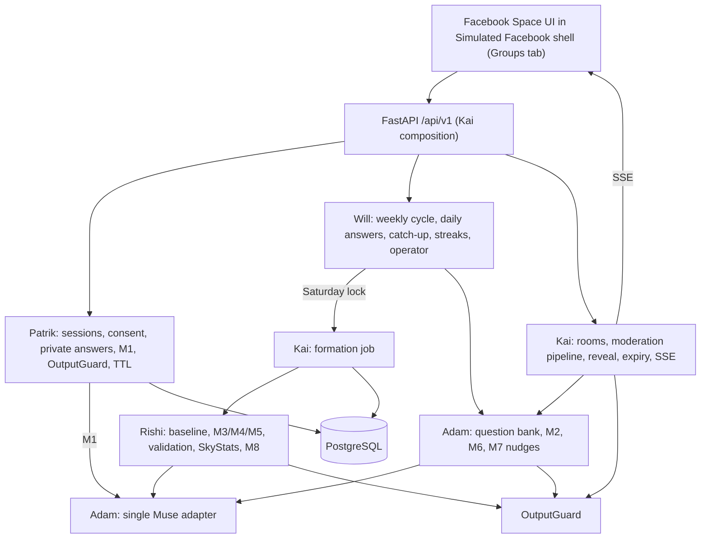

# Architecture (Facebook Space 2.0.0)
Status: design. Main holds the mock Facebook shell (`web/`), contracts and fixtures. Server code is restored per owner from `archive/group-quests-before-pivot` during step 2 and retested.

## Package layout
| Path | Owner |
| --- | --- |
| `server/app/`, `server/orchestration/`, `server/chat/`, `pyproject.toml`, migration order | Kai |
| `server/matching/` | Rishi |
| `server/providers/`, `server/planning/` | Adam |
| `server/cycle/`, `server/voice/` | Will |
| `server/privacy/`, `db/privacy/` | Patrik |
| `web/src/features/constellations/{sky,chat}/` | Kai |
| `web/src/features/constellations/formation/` | Rishi |
| `web/src/features/constellations/nudges/` | Adam |
| `web/src/features/constellations/{daily,operator}/` + Groups tab routing | Will |
| `web/src/features/constellations/privacy/` | Patrik |
| `contracts/` | shared; change via DECISIONS.md |

## Rules
No browser-to-Muse calls. One Muse adapter. OutputGuard on every Muse public text and every chat message. Only orchestration commits cross-owner effects. No cross-owner internal imports; use the ports in protocol.ts. Owners mount routers through Kai's registry. Stack: React/Vite/TypeScript frontend (existing); Python FastAPI + PostgreSQL server.

## Latency plan
| Stage | Calls | When |
| --- | --- | --- |
| M1 safety | 1 per answer / chat message | at submit |
| M2 follow-up | ≤1 per answer | at submit |
| M3 + M4 | 1 each per community | Saturday lock |
| M5 names | 1 per constellation | parallel after M4 |
| M8 Sky | 1 per cycle | after formation |
| M7 nudge | 1 per room | mid-week |
| M6 questions | batch | weekly, offline |
